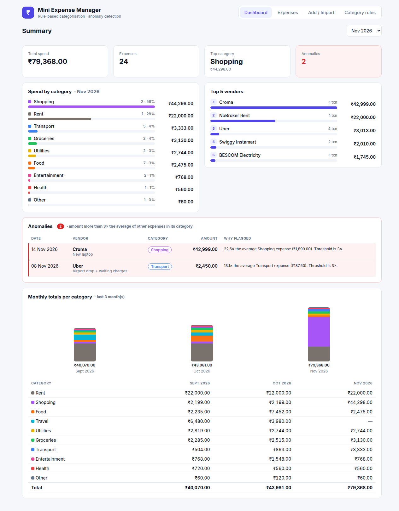
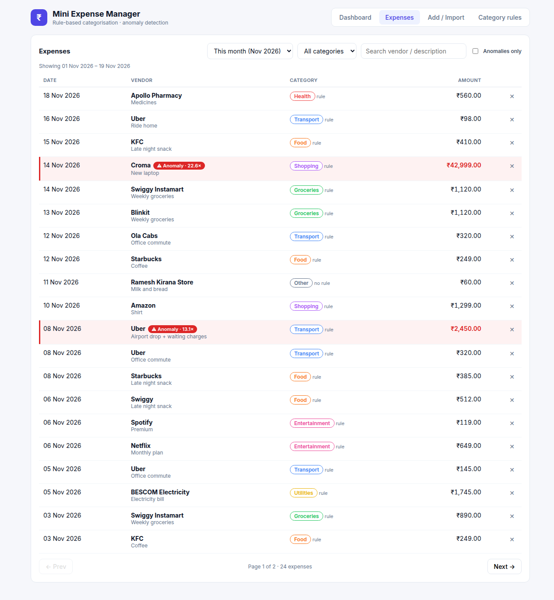
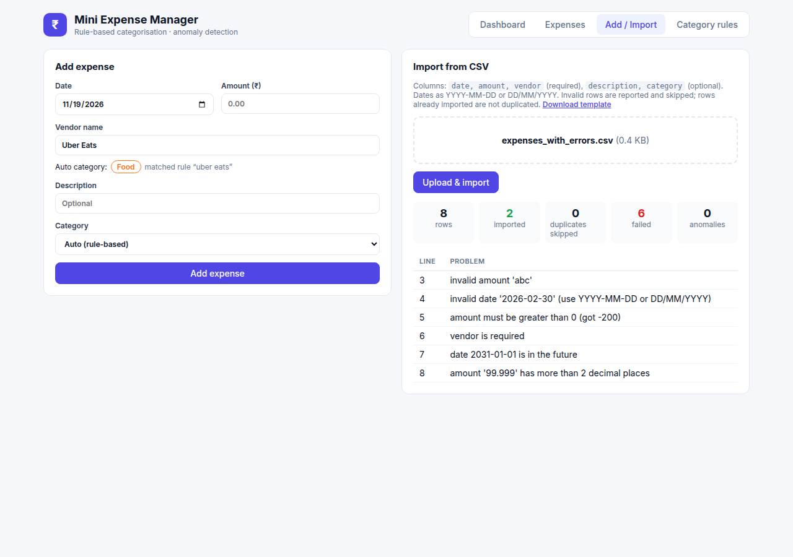
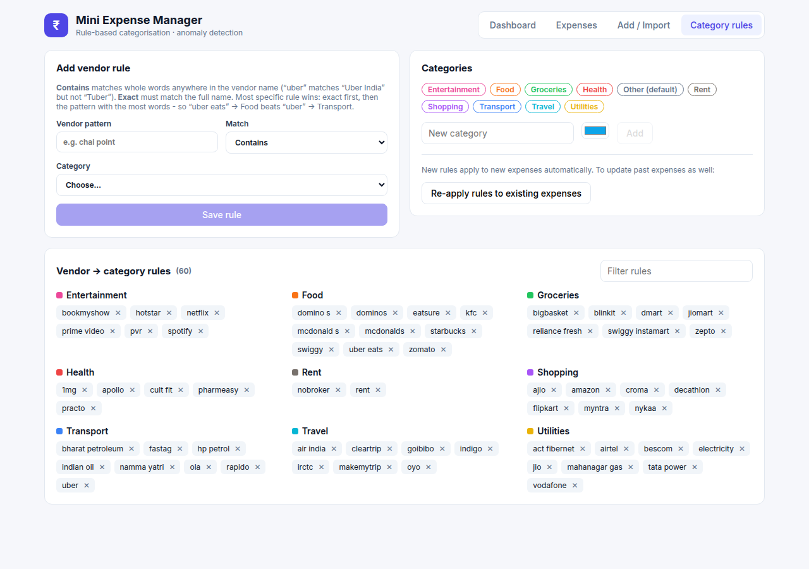

# Mini Expense Manager

A full-stack app for tracking daily expenses, built for the iConcile Technologies assignment. You can add expenses by hand or upload a CSV. Each expense is categorized automatically from its vendor name using editable rules, and expenses that are unusually large for their category are flagged.



## Features

| Requirement | How it's implemented |
|---|---|
| Add expense manually | Form with date, amount, vendor and description. While you type the vendor name, it shows which category it will get (*"Food – matched rule 'uber eats'"*). You can override the category and tick "always categorize this vendor this way" to create a rule. |
| Upload via CSV | Drag-and-drop upload. Accepts RFC 4180 quoting, header aliases (`Vendor Name`, `merchant`…), `YYYY-MM-DD` / `DD/MM/YYYY` / `7 Nov 2026` dates, and amounts like `₹1,200`. Each invalid row is reported with its line number and a reason; valid rows are still imported. Rows already in the database are skipped, so re-uploading a file is safe. **Download template** generates about 6 months of example expenses ending today, so its dates never go stale. |
| Rule-based categorization | `vendor_rule` table (60 seeded Indian vendors) with **EXACT** and whole-word **CONTAINS** matching. The most specific rule wins, so `Uber Eats` → Food while `Uber` → Transport. Rules can be added, deleted and re-applied to past expenses from the UI; categories you chose manually are never overwritten. |
| Anomaly detection | An expense is flagged if its amount is **more than 3× the average of the other expenses in its category**. Flagged rows are highlighted red with a badge and an explanation (*"22.6× the average Shopping expense (₹1,899)"*). |
| Dashboard | Month picker (or all time), total spend, **totals per category**, **top 5 vendors**, **anomaly count and list**, and a 6-month **monthly totals per category** chart and table. |
| Expense list | Period filter (**this month** by default, last 3 / 6 / 12 months, all time, or a **custom date range** that only takes effect when you press **Apply**), plus category, text search and "anomalies only". The exact dates shown are always spelled out ("Showing 01 Sep 2026 – 19 Nov 2026"). Anomalies are highlighted in red with the reason, and expenses can be deleted (anomalies are recomputed). |

## Tech stack

- **Backend:** Java 17, Spring Boot 3.3 (Web, Data JPA, Validation), Flyway, JUnit 5
- **Database:** PostgreSQL 16
- **Frontend:** React 18 + TypeScript, Vite. Charts are plain CSS, with no chart or UI library.
- **Infra:** Docker Compose (Postgres + backend + frontend served by nginx)

## Running it

### Option A – Docker (recommended, one command)

```bash
docker compose up --build
```

Open **http://localhost:3000**, go to **Add / Import** and upload `sample-data/expenses_sample.csv` (72 expenses from Sep to Nov 2026, including deliberate anomalies). The dashboard fills in immediately. `sample-data/expenses_with_errors.csv` shows the row-level validation report.

> Ports used on the host: 3000 (UI) and 8080 (API). Postgres is not exposed, so it won't clash with a local database. The first build downloads Maven and npm dependencies and takes a few minutes; the UI starts once the API is healthy. To start again from an empty database: `docker compose down -v`.

### Option B – Run locally (for development)

Prerequisites: JDK 17+, Maven 3.9+, Node 18+, and a PostgreSQL 14+ server.

```bash
# 1. Database (either run one in Docker…)
docker run -d --name expenses-db -p 5432:5432 \
  -e POSTGRES_DB=expenses -e POSTGRES_USER=expenses -e POSTGRES_PASSWORD=expenses postgres:16-alpine
#    …or create it yourself:  createuser expenses -P (password: expenses); createdb -O expenses expenses

# 2. Backend – http://localhost:8080 (Flyway creates the schema and seed data on startup)
cd backend
mvn spring-boot:run

# 3. Frontend, in a second terminal from the project root – http://localhost:5173 (Vite forwards /api to :8080)
cd frontend
npm install
npm run dev
```

You can override the database connection with `DB_URL`, `DB_USER` and `DB_PASSWORD`. Anomaly settings are in `backend/src/main/resources/application.yml` (`app.anomaly.multiplier`, `app.anomaly.min-peers`).

### Tests

```bash
cd backend && mvn test
```

These are unit tests for the core logic: the rule engine (specificity, whole-word matching, normalization), the anomaly detector (leave-one-out average, exactly-3× boundary, too-few-peers) and the CSV parser (quoting, BOM, date and amount formats, per-row errors with line numbers).

## API

| Method | Endpoint | Purpose |
|---|---|---|
| `GET` | `/api/expenses?from=YYYY-MM-DD&to=YYYY-MM-DD&month=YYYY-MM&categoryId=&anomaliesOnly=&q=&page=&size=` | Paginated, filterable list (`from`/`to` are inclusive; `month` is a one-month shortcut) |
| `POST` | `/api/expenses` | Create `{date, amount, vendorName, description?, categoryId?, rememberVendor?}` |
| `PUT` / `DELETE` | `/api/expenses/{id}` | Update / delete (anomalies are recomputed) |
| `POST` | `/api/expenses/upload` | Multipart CSV upload. Returns `{totalRows, imported, duplicatesSkipped, failed, anomaliesAmongImported, errors[]}` |
| `GET` | `/api/expenses/categorize?vendor=` | Preview which category/rule a vendor would get |
| `GET` | `/api/dashboard?month=YYYY-MM` | Dashboard summary (omit `month` for all time) |
| `GET` / `POST` | `/api/categories` | List / create categories |
| `GET` / `POST` / `DELETE` | `/api/rules`, `/api/rules/{id}` | Manage vendor rules (POST updates an existing rule with the same pattern and match type) |
| `POST` | `/api/rules/reapply` | Re-categorize existing non-manual expenses with the current rules |

API errors have the shape `{status, error, details[], timestamp}`, and validation failures list the problem with each field.

## Project structure

```
backend/src/main/java/com/iconcile/expenses/
  domain/      Pure Java, no Spring: VendorNormalizer, VendorCategorizer, AnomalyDetector, CsvExpenseParser
  entity/      JPA entities: Category, VendorRule, Expense (+ CategorySource, ExpenseSource)
  repository/  Spring Data repositories, including the dashboard aggregate queries
  service/     Transactions and orchestration: ExpenseService, CsvImportService, AnomalyService, RuleService, DashboardService
  web/         REST controllers, DTOs, global exception handler
  config/      Anomaly settings, clock, CORS
backend/src/main/resources/db/migration/   Flyway: V1 schema, V2 seed categories + rules, V3 batch-friendly ids
frontend/src/  App, typed API client, components (Dashboard, ExpenseList, ExpenseForm, CsvUpload, RulesPanel)
sample-data/   Demo CSV + a CSV full of deliberate errors
```

## Assumptions

- **Single user, single currency (INR).** No authentication; amounts are shown as ₹.
- **"Average for its category" means the average of the *other* expenses in that category, over all time.** If the expense were included in its own average, a big outlier would raise the average enough to hide itself (with 3 expenses, being more than 3× the average is mathematically impossible). "More than 3×" is strict, so exactly 3× is not flagged.
- **An expense is only judged once its category has at least 2 other expenses**, because an average of one value is not a meaningful baseline. This is configurable.
- **Anomaly flags are relative and can change.** Adding a large expense can un-flag or flag older ones, because the category average moves.
- Amounts must be > 0 with at most 2 decimal places; dates cannot be in the future. Refunds and negative amounts are out of scope.
- "Today" (for the no-future-dates check) is the server's local date. The Docker setup runs the backend in **IST (Asia/Kolkata)** so it matches the user's calendar date.
- Slash dates in CSVs are read **day-first** (`05/11/2026` = 5 Nov), the Indian convention.
- If a CSV has a `category` column whose value matches an existing category, that category is used and treated as a manual choice. Otherwise the rules decide.
- A CSV row is a duplicate if the same date, amount, vendor and description already exist in the database. Identical rows *within one file* are kept, since two equal auto-rickshaw fares on the same day are normal.
- Vendors that match no rule go to the default **Other** category.
- The "Last N months" filters use whole calendar months up to today: on 19 Nov, "Last 3 months" means 1 Sep – 19 Nov. This matches the monthly totals on the dashboard.

## Design note

See **[DESIGN.md](DESIGN.md)**. In short:

- **Categorization** uses normalized vendor names and EXACT / whole-word CONTAINS rules, where the most specific rule wins and categories the user chose by hand are never overwritten.
- **Anomalies** compare each amount with the leave-one-out category average using exact decimal arithmetic. Flags are stored and recomputed for every affected category in the same transaction as the write that changed it.
- **Data model:** three tables, money stored as `NUMERIC(12,2)` / `BigDecimal`, and the schema owned by Flyway with CHECK constraints.
- **No N+1 queries:** reads use fetch joins and aggregates (fixed query count per request); CSV imports are JDBC-batched via a pooled id sequence.
- **Trade-offs:** no authentication; an O(n) per-category recompute in Java instead of a SQL window function; the rule cache is in memory on a single node.

## Screenshots

| Expenses (anomalies highlighted) | Add / CSV import with validation report |
|---|---|
|  |  |


